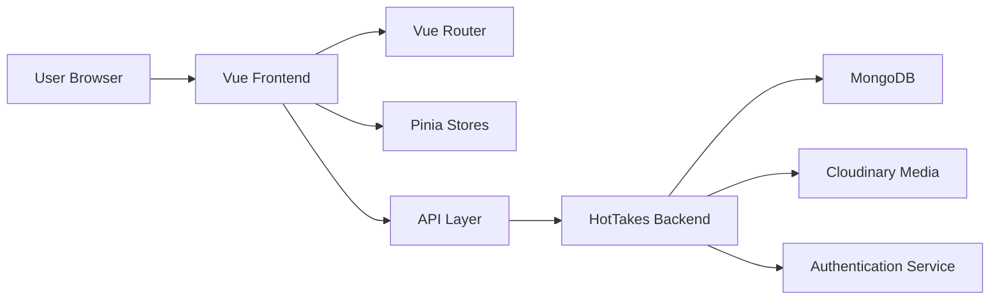

# 🍽️ HotTakesFrontend

A modern restaurant web application built with Vue 3, Vite, and Tailwind CSS for ordering, checkout, user accounts, and admin management.

<div align="center">

[](https://hot-takes-restaurant-frontend.vercel.app/)
[](https://vuejs.org/)
[](https://vite.dev/)
[](https://tailwindcss.com/)

</div>

## 🌐 Live Project

Visit the app here: https://hot-takes-restaurant-frontend.vercel.app/

## ✨ Overview

HotTakesFrontend is the customer-facing side of the HotTakes restaurant platform. It delivers a clean and responsive experience for:

- browsing the menu
- managing cart items
- placing food orders
- user registration and login
- password recovery
- checkout and payment success flow
- admin dashboard operations

## 🧩 Core Features

- 🍔 Restaurant menu browsing
- 🛒 Cart and checkout flow
- 🔐 Authentication and protected routes
- 👤 Customer dashboard and settings
- 🧑‍💼 Admin tools for food, orders, and users
- 💳 Payment success experience
- 📱 Responsive design for mobile and desktop
- ⚡ Fast frontend performance with Vite

## 🛠️ Tech Stack

- Vue 3
- Vite
- Vue Router
- Pinia
- Tailwind CSS
- Axios
- VeeValidate + Yup
- Font Awesome + Lucide icons

## 🏗️ Architecture



## 📁 Project Structure

```text
HotTakesFrontend/
├── public/
├── src/
│   ├── api/
│   ├── assets/
│   ├── components/
│   ├── composables/
│   ├── router/
│   ├── stores/
│   ├── views/
│   ├── App.vue
│   └── main.js
├── index.html
├── jsconfig.json
├── package.json
├── postcss.config.js
├── tailwind.config.js
├── vite.config.js
├── vercel.json
├── README.md
└── .gitignore
```

## ✅ Prerequisites

Before starting locally, make sure you have:

- Node.js 18 or newer
- npm installed
- The backend service running locally or remotely

## 🚀 Local Development

Install dependencies:

```bash
npm install
```

Start the development server:

```bash
npm run dev
```

Open the app in the browser at:

```text
http://localhost:5173
```

## 📦 Production Build

Build the project for production:

```bash
npm run build
```

Preview the production build locally:

```bash
npm run preview
```

## 🧪 Scripts

```bash
npm run dev      # starts the Vite development server
npm run build    # creates a production bundle
npm run preview  # previews the production build locally
npm run format   # formats source files with Prettier
```

## 🧭 Route Overview

The app uses Vue Router with protected routes and role-aware navigation.

- `/` — Home page
- `/menu` — Menu browsing
- `/cart` — Shopping cart
- `/checkOut` — Checkout
- `/login` — Login page
- `/register` — Registration page
- `/forgot-password` — Password recovery
- `/reset-password/:token` — Reset password
- `/dashboard` — Customer dashboard
- `/admin` — Admin dashboard

## 🔌 Backend Integration

This frontend communicates with the backend through the API client and Pinia stores. Ensure the backend is reachable before testing authentication, order creation, admin management, and payment workflows.

## ☁️ Deployment

This project is configured for Vercel deployment and is ready for static hosting workflows. Production deployment should use the live backend URL appropriate for your environment.

## 📜 License

This project is licensed under the ISC license.

## 🤝 Contributing

Contributions are welcome. Please keep UI changes consistent with the current design language and validate user flows before submitting updates.
